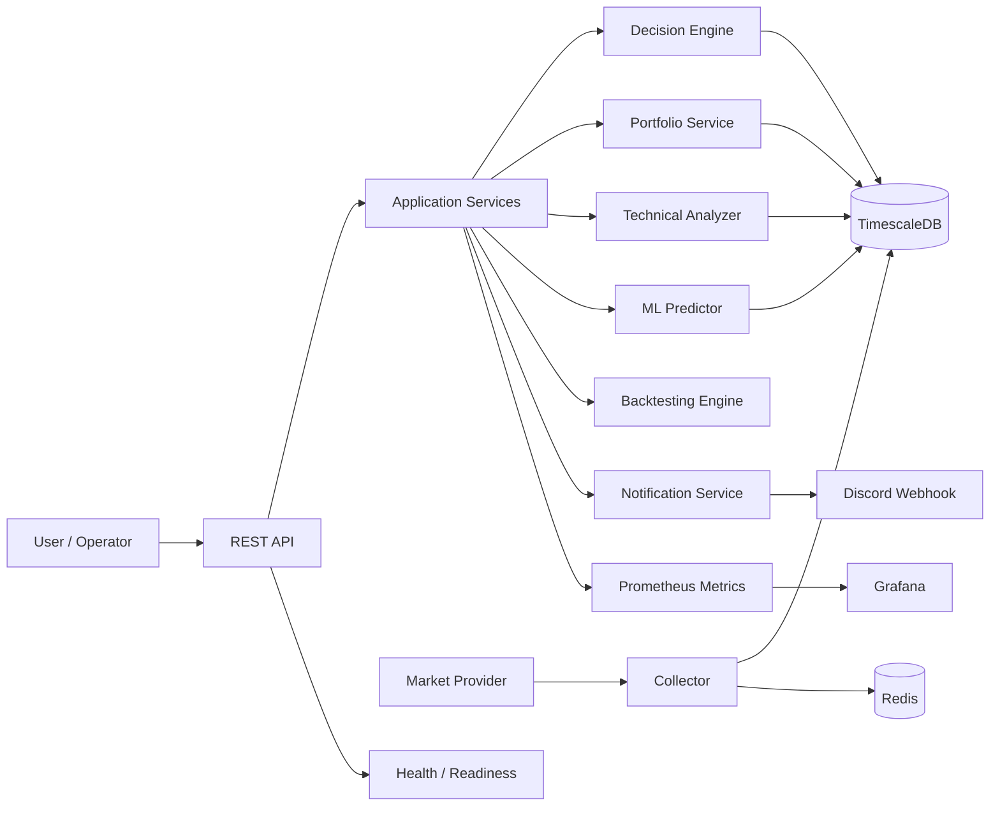

# Atlas Architecture Final Proposal

## 1. Project Thesis

Atlas is an AI-assisted portfolio decision support platform for stocks and ETFs. It is explicitly not an automated trading system. Its purpose is to help investors answer operational questions such as:

- Buy?
- Add to position?
- Hold?
- Reduce?
- Sell?

Every recommendation must include a confidence score, explanation, and risk context.

## 2. Architectural Direction

The architecture must follow Clean Architecture and align with repository rules:

- business logic must not live inside HTTP handlers,
- dependencies must be injected,
- interfaces must be exposed for every module,
- configuration must be externalized,
- all components must be observable,
- all logic must be testable and deterministic.

## 3. Target Architecture

### Layered structure

1. API Layer
   - REST handlers
   - request validation
   - response shaping
   - OpenAPI-friendly contract surface

2. Application Layer
   - use cases
   - orchestration
   - service interfaces
   - domain service orchestration

3. Domain Layer
   - market data domain
   - portfolio domain
   - technical analysis domain
   - ML prediction domain
   - decision domain
   - backtesting domain

4. Infrastructure Layer
   - market provider adapters
   - TimescaleDB repositories
   - Redis cache access
   - Prometheus exporter
   - Discord notification adapter
   - ML model adapter

## 4. Core Components

### 4.1 Collector Service

Responsibilities:
- fetch market data from external providers,
- normalize incoming data into canonical OHLCV format,
- persist raw and normalized market data,
- emit ingestion metrics.

### 4.2 Technical Analyzer

Responsibilities:
- calculate indicators:
  - EMA
  - RSI
  - MACD
  - ATR
  - ADX
  - OBV
  - volatility and trend summaries
- persist, version, and expose indicator results.

### 4.3 ML Predictor

Responsibilities:
- consume feature vectors derived from price and indicator history,
- predict correction probability and confidence,
- store prediction output with model version metadata,
- expose prediction metrics and quality evaluation.

### 4.4 Portfolio Service

Responsibilities:
- maintain portfolio and watchlist state,
- calculate position exposure,
- assess profit/loss, concentration, and risk posture,
- provide context required by decision generation.

### 4.5 Decision Engine

Responsibilities:
- merge technical, ML, portfolio, and risk signals,
- produce a structured recommendation object,
- always include explanation and confidence,
- persist recommendation results and input traceability.

### 4.6 Notification Service

Responsibilities:
- send high-priority actions to Discord,
- support future notification channels,
- avoid sending non-actionable content.

### 4.7 Backtesting Engine

Responsibilities:
- validate strategies on historical data without data leakage,
- evaluate performance, risk, and model quality,
- generate reports and metrics for strategy promotion.

### 4.8 Observability Layer

Responsibilities:
- Prometheus metrics exposition,
- Grafana dashboards,
- structured log collection,
- health and readiness endpoints.

## 5. Component Diagram

## 6. Deployment Model

- Primary deployment target: Docker Compose
- Kubernetes-ready architecture is mandatory
- All services should be stateless except storage services
- State must be externalized to TimescaleDB and Redis
- Application services should expose `/health` and `/metrics`

## 7. Architecture Decisions

### Decision 1: Use Go for backend services
Reason: strong performance, good observability support, clean concurrency model, and alignment with repo standards.

### Decision 2: Use TimescaleDB for time-series data
Reason: recommended by current documentation and ideal for prices, indicators, and predictions.

### Decision 3: Use Redis for short-lived cache and coordination
Reason: helps reduce provider access cost and supports temporary computations and rate limiting.

### Decision 4: Separate decision logic from transport concerns
Reason: required by Clean Architecture and repository rules.

### Decision 5: Backtesting is a mandatory gate
Reason: finance-grade validation requires strict temporal correctness and historical testing.

## 8. Open Questions

The following items require clarification before implementation begins:

- final market data provider choice,
- user and auth model,
- exact portfolio model and risk policy,
- specific ML model lifecycle and training pipeline,
- exact recommendation scoring weights,
- alert severity rules.

## 9. Approval Summary

This proposal defines the final structural direction for Atlas without writing production code. It is intentionally architecture-first and ready for review.

Review has been done and approved.
