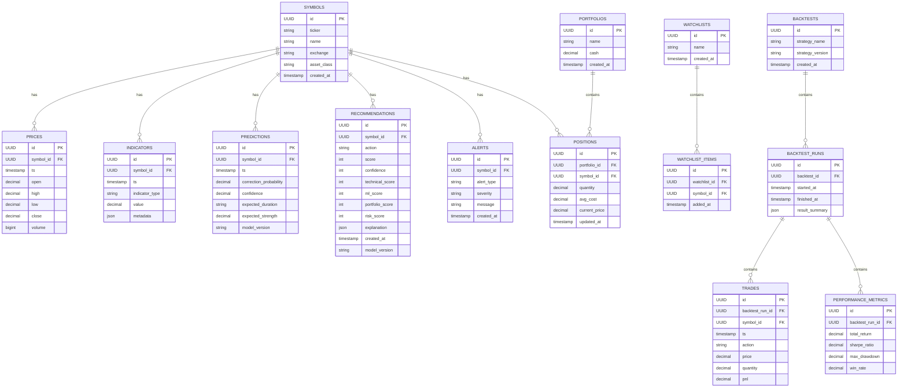

# Atlas Database Final Proposal

## 1. Database Strategy

Atlas must use TimescaleDB as the primary persistence layer for time-series data, with relational tables for portfolios, watchlists, alerts, recommendations, and backtesting metadata.

The recommended data model follows a hybrid structure:

- Time-series hypertables for market, indicator, prediction, and recommendation history.
- Relational tables for portfolio ownership, watchlists, alerts, and backtesting entities.
- Redis for ephemeral state and cache, not as the source of truth.

## 2. Core Entities

### 2.1 `symbols`
Stores asset registry metadata.

Fields:
- id
- ticker
- name
- exchange
- asset_class
- created_at

### 2.2 `prices`
Stores OHLCV time-series data.

Fields:
- id
- symbol_id
- timestamp
- open
- high
- low
- close
- volume

Recommended storage: hypertable with compression.

### 2.3 `indicators`
Stores calculated technical indicator output.

Fields:
- id
- symbol_id
- timestamp
- indicator_type
- value
- metadata

### 2.4 `predictions`
Stores ML output for a given symbol and time.

Fields:
- id
- symbol_id
- timestamp
- correction_probability
- confidence
- expected_duration
- expected_strength
- model_version

### 2.5 `portfolios`
Stores portfolio containers.

Fields:
- id
- name
- cash
- created_at

### 2.6 `positions`
Stores positions held within a portfolio.

Fields:
- id
- portfolio_id
- symbol_id
- quantity
- avg_cost
- current_price
- updated_at

### 2.7 `watchlists`
Stores user or system watchlists.

Fields:
- id
- name
- created_at

### 2.8 `watchlist_items`
Stores symbols attached to a watchlist.

Fields:
- id
- watchlist_id
- symbol_id
- added_at

### 2.9 `alerts`
Stores generated operational or recommendation alerts.

Fields:
- id
- symbol_id
- alert_type
- severity
- message
- created_at

### 2.10 `recommendations`
Stores final AI recommendation outputs.

Fields:
- id
- symbol_id
- action
- score
- confidence
- technical_score
- ml_score
- portfolio_score
- risk_score
- explanation
- created_at
- model_version

## 3. ERD

## 4. Storage and Performance Rules

- Use hypertables for all time-sequence datasets.
- Enable compression for historical storage.
- Keep 10-year retention policy as a target baseline.
- Use foreign keys for relational references and stable identity mapping.
- Use indexes on:
  - `symbols.ticker`
  - `prices(symbol_id, timestamp)`
  - `indicators(symbol_id, timestamp, indicator_type)`
  - `predictions(symbol_id, timestamp)`
  - `recommendations(symbol_id, created_at)`

## 5. Data Integrity Principles

- Reject invalid symbols.
- Enforce timestamp consistency for time-series writes.
- Store model version with every prediction and recommendation.
- Keep recommendation inputs traceable.
- Do not allow recommendation output without explanation and confidence.

## 6. Additional Notes

The database design must support:

- historical replay,
- model rollback,
- backtesting traceability,
- portfolio evaluation,
- operational alerting.
